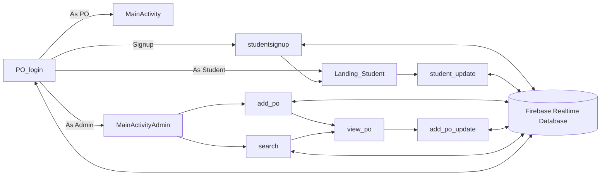

# Inplace Smart Placement Solutions

An Android app for a university placement office. Students, placement
officers and administrators sign in to one app and each get their own
dashboard. Accounts are stored in Firebase Realtime Database, so a
student who signs up on one phone can sign in on another.

It is a student project and still a prototype: the account screens talk
to Firebase, while the job, company and chat screens run on built-in
sample data. The table below says which is which.

## What works

| Role | Screen | Backed by |
| --- | --- | --- |
| Everyone | Sign in, choosing *As Student*, *As PO* or *As Admin* | Firebase (`student`, `PlacementOfficer`, `admin` nodes) |
| Student | Sign up (name, email, phone, gender, degree, CGPA, batch, skills, experience) | Firebase |
| Student | Edit or delete own profile | Firebase |
| Admin | Add a placement officer, view, edit or delete one | Firebase |
| Admin | List all placement officers | Firebase |
| Placement officer | Add companies and jobs, notify students, update the selected-students list | Sample data, nothing is saved |
| Student | Browse job notifications, view selected students for a job, chat | Sample data, nothing is saved |
| Admin | Search companies | Sample data |

There is no screen for creating an admin. Add one by hand in the Firebase
console under `admin/<any-key>` with `username` and `password` fields.



## Building

The build needs JDK 21 and the Android SDK (platform 36). Gradle and the
Android Gradle Plugin come from the wrapper, so nothing else has to be
installed.

### 1. Firebase config

The app reads its Firebase project from `app/google-services.json`, which
is not in the repository because it carries the project's API key.

- To run against a real database, create an Android app with package
  name `com.example.smd_po_module` in your Firebase project, download its
  `google-services.json` into `app/`, and enable Realtime Database.
- To only build and run the tests, copy the placeholder:

  ```sh
  cp app/google-services.json.example app/google-services.json
  ```

  The APK builds and the screens open, but sign-in and saves fail
  because the placeholder points at no project.

### 2a. Build with Docker

The `Dockerfile` installs the SDK command-line tools, runs the unit tests
and builds the debug APK. It always uses the placeholder config, so your
real `google-services.json` never ends up in an image.

```sh
docker build -t smd-po-module .
docker run --rm -v "$PWD/out:/out" smd-po-module
```

`out/app-debug.apk` is the result. On an Apple silicon Mac add
`--platform linux/amd64` to both commands: Google ships the SDK build
tools for x86-64 Linux only.

### 2b. Build locally

With `ANDROID_HOME` pointing at an SDK that has platform 36:

```sh
./gradlew assembleDebug        # app/build/outputs/apk/debug/app-debug.apk
./gradlew testDebugUnitTest    # JUnit tests on the JVM
./gradlew lintDebug            # Android lint
```

Install the APK with `adb install app/build/outputs/apk/debug/app-debug.apk`
or open the project in Android Studio.

## Project layout

```
app/src/main/java/com/example/smd_po_module/
  ui/login/        PO_login screen with a small presenter/interactor for the empty-field checks
  FormRules.java   plain-Java validation shared by every form (email, CGPA, allowed characters)
  ValidateFilter*, num   InputFilters that block disallowed characters as you type
  student, PlacementOfficer, admin   Firebase data classes
  classes/         hard-coded sample jobs, students and companies for the prototype screens
  adapter_*        RecyclerView adapters for those lists
app/src/test/      FormRulesTest
```

## Design notes

- **Validation in one place.** Every form used to repeat its own email
  regex and empty-field checks, with a flag that later checks
  overwrote. They now call `FormRules`, which has no Android imports so
  it runs as a plain JUnit test.
- **One Firebase lookup for sign-in.** The three roles differ only in the
  database node and the name field, so `PO_login.signIn` takes those as
  arguments. The record's key is passed on to the student dashboard, which
  is how *Edit/Delete Profile* finds the right record.
- **Shared lists use global flags.** The job and student lists are reused
  by several flows, and `Global.intent`/`Global.intent1` record which
  flow opened them. That is fragile, but it is how the prototype screens
  hang together, so it is documented here rather than rewritten.

## Known limitations

- Passwords are stored and compared in plain text in the database, and
  any client with the database URL can read them unless the database
  rules forbid it. Moving to Firebase Authentication is the real fix.
- The sample-data screens do not save anything.
- There are no instrumented UI tests. The template one in
  `app/src/androidTest` needs a device or emulator.

## Licence

MIT, see [LICENSE](LICENSE). The Nunito font in `app/src/main/res/font` is
from Google Fonts under the SIL Open Font License.
